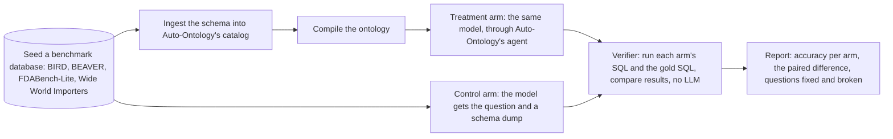
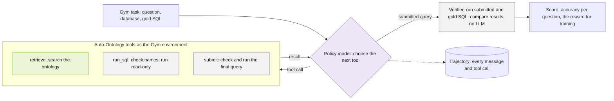

# Evaluation flow, now and next

## Now: paired arms on NeMo Gym

Each question runs twice with the same model: the control arm
(`schema_only_sql`) gets the question and a schema dump in one prompt, and the
treatment arm (`auto_ontology_sql`) runs Auto-Ontology's agent in-process at
the revision pinned in [`pyproject.toml`](../pyproject.toml). One verifier
(`ontology_sql_eval/gym/exec_match.py`) runs each arm's SQL and the gold SQL and
compares the results by each benchmark's official rule, with no LLM. Details
are in [resources_servers/README.md](../resources_servers/README.md).

In the treatment arm, Gym still calls its policy model and discards the answer;
Auto-Ontology's agent writes the SQL, and its own model calls are routed
through Gym model servers so their tokens are counted
(`ontology_sql_eval/gym/model_routing.py`).

## Next: ReAct tools on NeMo Gym

**Planned, not built yet.** Now, Gym's policy model answers only in the
control arm; in the treatment arm its answer is discarded and Auto-Ontology's
agent writes the SQL. With the ReAct agent, the plan is for the policy model to
call Auto-Ontology's tools directly, with the same verifier scoring each
submitted query as the reward.

Green: model call. Gray: deterministic (SQL or rules). Purple: model-chosen tool (ReAct). Dashed: off by default or optional.
